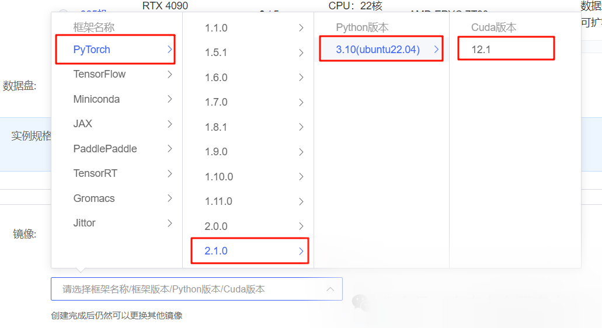

# [Large Model] Gemma2b-Instruct Lora Fine Tuning

In this section, we will briefly introduce how to leverage transformers, PEFT, and other frameworks to implement LoRa for the Gemma2b model.

In this section, we will briefly introduce how to base on transformers. Frameworks such as PEFT. Lora fine-tuning of the Gemma2b model. Lora is an efficient fine-tuning method. For a deeper understanding of its principles, refer to the blog: Lora | Deep Understanding.

This tutorial will provide a nodebook file in the same directory for everyone to better learn from.

### Environmental Preparation

Rent a 3090-class 24G VRAM graphics card machine on the Autodl platform, as shown in the image, select the mirror by `PyTorch-->2.1.0-->3.10(ubuntu22.04)-->12.1`.
Next, open JupyterLab on the server you just rented and start configuring the environment, downloading models, and running demos.



### Environment Configuration

After completing the basic environment configuration and local model deployment, you also need to install some third-party libraries. You can use the following command:

```
python -m pip install --upgrade pip
# Changing PyPI Source to Accelerate Library Installation
pip config set global.index-url https://pypi.tuna.tsinghua.edu.cn/simple
pip install modelscope==1.9.5
pip install "transformers>=4.40.0"
pip install streamlit==1.24.0
pip install sentencepiece==0.1.99
pip install accelerate==0.29.3
pip install datasets==2.19.0
pip install peft==0.10.0
MAX_JOBS=8 pip install flash-attn --no-build-isolation

```

>

Note: Flash-Attention installation will be relatively slow, approximately taking about ten minutes.

In this section, we will fine-tune the dataset to be placed in the root directory /dataset.

### Model Download

Download the model using the snapshot_download function in ModelScope. The first parameter is the model name, and the second parameter is the cache directory for the model download.

Create a new file named model_download.py under the /root/autodl-tmp path and enter the following content within it: After pasting the code, remember to save the file. As shown in the figure. Run `python /root/autodl-tmp/model_download.py` to execute the download. The model size is 15 GB. Downloading the model takes about 2 minutes.

```
import torch
from modelscope import snapshot_download, AutoModel, AutoTokenizer
import os
model_dir = snapshot_download('Lucachen/gemma2b', cache_dir='/root/autodl-tmp', revision='master')

```

### Instruction Set Construction

The fine-tuning of LLM generally refers to the instructional fine-tuning process. As mentioned, the micro-tuning data we use is in the form:

```
{
"instruction": "Answer the following user questions, and output only the answers."
"input": "1+1 equals to what?"
  "output": "2"
}

```

Among them, `instruction` is the user's instruction, which informs the model of the task it needs to complete; `input` is the user's input, which is the necessary content for completing the user's instruction; `output` is the model's output.

Our core training objective is to enable the model to understand and follow user instructions. Therefore, when constructing an instruction set, we should tailor it to our target task. For instance, in this section, we use the Chat-Zhenhuan project co-authored by the author as an example. Our goal is to build a personalized LLM that can simulate the dialogue style of Zhenhuan. Consequently, the instructions we construct are similar to:

```
{
"instruction": "Who are you?"
  "input": "",
"output": "My father is Zhen Yuandao, a minor official at the Dali Temple.
}

```

All the instruction datasets we constructed are located in the root directory.

### Data Formatting

The training data for `Lora` requires formatting and encoding before being input into the model for training. Those familiar with the Pytorch model training process will know that we generally need to encode the input and output texts of an input sample into `input_ids` and `labels`, respectively, and the resulting encoded results are multi-dimensional vectors. We first define a preprocessing function that is used to encode each sample's input and output texts and return an encoded dictionary:

-
-
-
-
-
-
-
-
-
-
-
-
-
-
-
-
-
-
-

```
def process_func(example):    MAX_LENGTH = 384    # The tokenizer will split a Chinese character into multiple parts.token，Therefore, some maximum lengths need to be relaxed to ensure the integrity of data.    input_ids, attention_mask, labels = [], [], []    instruction = tokenizer(f"<start_of_turn>system\nNow you are playing the role of Empress Dowager Zhen Huan, the woman by the Emperor's side.<end_of_turn>\n<start_of_turn>user\n{example['instruction'] + example['input']}<end_of_turn>\n<start_of_turn>model\n", add_special_tokens=False)    #response = tokenizer(f"{example['output']}", add_special_tokens=False)    response = tokenizer(f"{example['output']}<end_of_turn>model", add_special_tokens=False)    input_ids = instruction["input_ids"] + response["input_ids"]    attention_mask = instruction["attention_mask"] + response["attention_mask"] + [1]  # Becauseeos tokenWe need to pay attention to it, so...1    labels = [-100] * len(instruction["input_ids"]) + response["input_ids"]    if len(input_ids) > MAX_LENGTH:  # Make a cut        input_ids = input_ids[:MAX_LENGTH]        attention_mask = attention_mask[:MAX_LENGTH]        labels = labels[:MAX_LENGTH]    return {        "input_ids": input_ids,        "attention_mask": attention_mask,        "labels": labels    }

```

The `Prompt Template` used by `gemma` is as follows:

-
-
-
-
-
-
-

```
<start_of_turn>system You are a small assistant.<end_of_turn><start_of_turn>user Hello.<end_of_turn><start_of_turn>model Hello! I'm also glad to meet you! Do you have any questions or topics you'd like to chat about? Hello! It's great that you've come. Do you have any questions or need my assistance?

```

### Loading tokenizer and half-precision model

The model is loaded in half-precision format. If your GPU is relatively new, you can load it using `torch.bfolat`. For custom models, make sure to specify the `trust_remote_code` parameter as `True`.

```
tokenizer = AutoTokenizer.from_pretrained('/root/autodl-tmp/Lucachen/gemma2b', use_fast=False, trust_remote_code=True)
model = AutoModelForCausalLM.from_pretrained('/root/autodl-tmp/Lucachen/gemma2b', device_map="auto",torch_dtype=torch.bfloat16)

```

### Define LoraConfig

The `LoraConfig` class can set many parameters, but there are not many main parameters. Let me briefly explain them for those interested in the source code.

-

`task_type`: Model type

-

`target_modules`: The name of the model layer that needs to be trained, mainly the layers in the `attention` part. Different models correspond to different names for these layers. It can be passed as an array, a string, or a regular expression.

-

`r`: The rank of `lora`, which can be seen in the principle of `Lora`.

-

`lora_alpha`: `Lora alaph`, see the principle of `Lora` for specific functions.

What is the scaling of `Lora`? Of course, it's not `r`, which is the rank. The scaling here is `lora_alpha/r`, and in this `LoraConfig`, the scaling is 4 times.

```
config = LoraConfig(
    task_type=TaskType.CAUSAL_LM,
    target_modules=["q_proj", "k_proj", "v_proj", "o_proj", "gate_proj", "up_proj", "down_proj"],
inference_mode=False, # training mode
r=8, # Lora rank
lora_alpha=32, # Lora alaph, specific function refer to Lora principle.
lora_dropout=0.1# Dropout ratio
)

```

### Customize TrainingArguments Parameters

The source code of the `TrainingArguments` class also explains the specific roles of each parameter. Of course, everyone can explore on their own, and here I will simply mention a few commonly used ones.

-

`output_dir`: The output path of the model

-

`per_device_train_batch_size`: As the name suggests, it is equivalent to `batch_size`.

-

`gradient_accumulation_steps`: Gradient accumulation. If your GPU memory is limited, you can set `batch_size` smaller and increase the gradient accumulation step accordingly.

-

`logging_steps`: how many steps, output once `log`

-

`num_train_epochs`: As the name suggests, `epoch`

-

`gradient_checkpointing`: Gradient Checkpointing. Once enabled, the model must execute `model.enable_input_require_grads()`, which can be explored by everyone on their own. Here, I will not elaborate further.

```
args = TrainingArguments(
    output_dir="./output/gemma2b",
    per_device_train_batch_size=4,
    gradient_accumulation_steps=4,
    logging_steps=10,
    num_train_epochs=3,
    save_steps=100,
    learning_rate=1e-4,
    save_on_each_node=True,
    gradient_checkpointing=True
)

```

### Using Trainer for Training

```
trainer = Trainer(
    model=model,
    args=args,
    train_dataset=tokenized_id,
    data_collator=DataCollatorForSeq2Seq(tokenizer=tokenizer, padding=True),
)
trainer.train()

```

### Save lora weights

```
lora_path='./gemma2b_lora'
trainer.model.save_pretrained(lora_path)
tokenizer.save_pretrained(lora_path)

```

### Loading LoRa Weighted Inference

After training, you can load the `lora` weights for inference using the following method:

-
-
-
-
-
-
-
-
-
-
-
-
-
-
-
-
-
-
-
-
-
-
-
-
-
-
-
-
-
-
-
-
-
-
-
-
-
-

```
from transformers import AutoModelForCausalLM, AutoTokenizerimport torchfrom peft import PeftModel
mode_path = '/root/autodl-tmp/Lucachen/gemma2b'lora_path = './gemma2b_lora' # lora weight path
# Loadingtokenizertokenizer = AutoTokenizer.from_pretrained(mode_path)
# Load the model model = AutoModelForCausalLM.from_pretrained(mode_path, device_map="auto", torch_dtype=torch.bfloat16)
# Load Lora weight model = PeftModel.from_pretrained(model, model_id=lora_path, config=config)
prompt = "Who are you?"messages = [    # {"role": "system", "content": "Now, you are playing the role of a woman close to the emperor--Zhen Huan"},    {"role": "user", "content": prompt}]
text = tokenizer.apply_chat_template(messages, tokenize=False, add_generation_prompt=True)
model_inputs = tokenizer([text], return_tensors="pt").to('cuda')
generated_ids = model.generate(    model_inputs.input_ids,    max_new_tokens=512)generated_ids = [    output_ids[len(input_ids):] for input_ids, output_ids in zip(model_inputs.input_ids, generated_ids)]
response = tokenizer.batch_decode(generated_ids, skip_special_tokens=True)[0]
print(response)

```

Complete fine-tuning script reference: https://github.com/datawhalechina/self-llm/blob/master/Gemma/04-Gemma-2B-Lora%E5%BE%AE%E8%B0%83.ipynb


## Payment

Here is a pay link on Stripe ( https://buy.stripe.com/3cs8yP7sY87d0vu9AB ). Please contact me lonlonago@foxmail.com after funding $89, and I will send you a complete data files , thank you!


